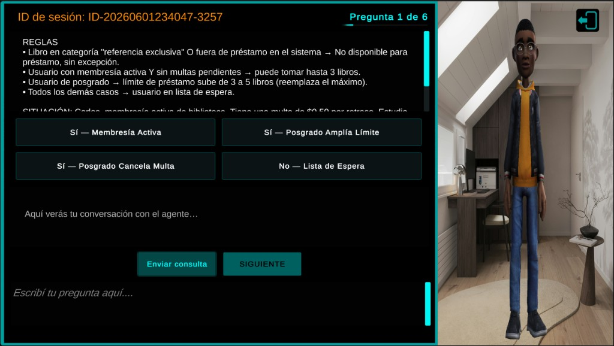
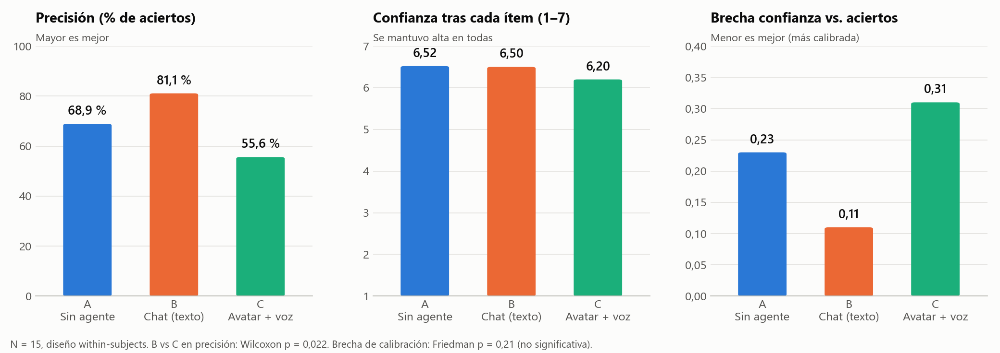
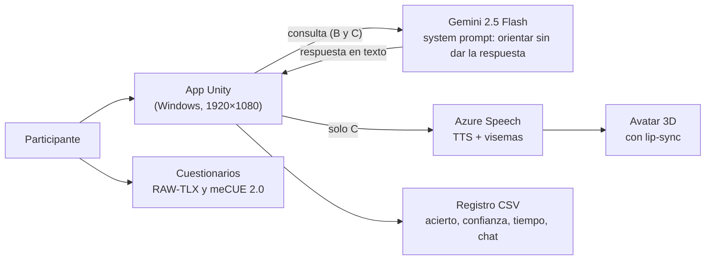

# 🤖 ¿Ayuda más un agente virtual con cara y voz?

**Un estudio con usuarios reales sobre cómo cambia el desempeño y la confianza según la forma en que se presenta un asistente de IA: sin agente, como chat de texto, o como avatar 3D que habla. El LLM y el prompt fueron los mismos en las dos versiones con agente.**

[English summary](#-english-summary) · [Resultados](#-resultados) · [Diseño del estudio](#-diseño-del-estudio) · [El prototipo](#-el-prototipo) · [Documentos](#-documentos)

Condición C: el participante lee las reglas y la situación, elige una respuesta y puede consultar al agente; el avatar lee en voz alta la misma respuesta que en la condición B aparece solo como texto.

🎥 **Demos en video:** [A · Sin agente](https://youtu.be/upMpOpCAWgQ) · [B · Chat de texto](https://youtu.be/U_A_y0d-Hxg) · [C · Avatar con voz](https://youtu.be/_h3h9BOnI18)

---

## 📊 Resultados

**Lo que encontré:**

1. **El chat de texto ganó en precisión:** 81,1 % de aciertos, contra 55,6 % con el avatar, **con el mismo LLM y el mismo prompt** (Wilcoxon p = 0,022; IC 95 % de la diferencia: 13 a 39 puntos). 11 de las 15 personas acertaron más con el texto que con el avatar.
2. **El avatar no aumentó la confianza.** Se mantuvo alta en las tres condiciones (6,2 a 6,5 de 7); fue algo menor con el avatar, no mayor.
3. **Con el avatar, la confianza se desalineó más de los aciertos:** brecha de 0,31 contra 0,11 en texto. La diferencia es descriptiva (Friedman p = 0,21): varias personas marcaron confianza alta y fallaron.
4. **El avatar hizo todo más lento:** ~177 s por pregunta contra ~114 s sin agente (~56 % más), y hubo más turnos de chat (4,4 contra 3,6) sin que eso mejorara los aciertos.
5. **Gustó, aunque rindió peor.** La estética del avatar obtuvo 5,6 de 7 (meCUE II) y la carga de trabajo percibida no cambió (RAW-TLX ≈ 4,3 en las tres). Es un caso claro de experiencia agradable que no se traduce en mejor desempeño.
6. **El agente no filtró respuestas:** 0 casos en los registros, aunque al menos un participante intentó que le diera la letra.

**¿Qué significa para quien diseña asistentes con IA?** En tareas donde la respuesta está en una regla escrita, ponerle cara y voz al asistente puede **costar precisión y tiempo** sin mejorar la confianza. Si se quiere conservar el avatar, conviene aligerar la voz y las esperas, o dejar que el usuario elija el modo texto.

---

## 🔬 Diseño del estudio

| | |
|---|---|
| **Pregunta** | ¿Cambian la precisión (RQ1), la confianza (RQ2) y la calibración entre ambas (RQ3) según cómo se presenta el agente? |
| **Participantes** | 15 adultos, reclutamiento abierto; la mayoría de 25 a 34 años y con estudios universitarios o técnicos |
| **Diseño** | *Within-subjects*: cada persona pasó por las tres condiciones, en orden contrabalanceado |
| **Tarea** | 6 preguntas de opción múltiple por condición sobre reglas ficticias (18 en total) |
| **Condiciones** | **A:** sin agente · **B:** chat con Gemini 2.5 Flash · **C:** el mismo chat leído por un avatar 3D con voz de Azure y sincronía labial |
| **Medidas** | Acierto, confianza (1 a 7) y tiempo por pregunta; registro del chat; RAW-TLX y meCUE 2.0 después de cada bloque |
| **Análisis** | Friedman y Wilcoxon pareado con corrección de Holm/Bonferroni (α = 0,05) |
| **Datos** | 270 respuestas registradas, 0 filas inválidas |

**Limitaciones:** la muestra es pequeña (N = 15); cada bloque tenía preguntas distintas, así que parte de la diferencia puede venir de la dificultad de los ítems; y el estudio corrió en las computadoras de los participantes, no en un entorno uniforme, lo que afecta la latencia de la voz y el render del avatar en la condición C. Los resultados orientan el diseño del prototipo; no son generalizables sin repetir el estudio.

---

## 🔧 El prototipo

- **Unity 6 (C#):** flujo del experimento (consentimiento, selección de condición, preguntas, confianza y pantalla final) y registro automático en CSV por sesión.
- **Gemini 2.5 Flash:** tutor que orienta sin revelar la letra; el mismo prompt en B y C.
- **Azure Speech:** síntesis de voz con visemas para la sincronía labial del avatar en C.
- **Privacidad:** consentimiento informado, ID de sesión anónimo y opción de salir y borrar los datos en cualquier momento.
- **Python:** scripts para generar las preguntas desde Word y las figuras de los informes ([`_tools/`](_tools/)).

Cómo abrirlo, compilarlo, configurar las API keys, el esquema del CSV y la referencia de cada script: [**`docs/REFERENCIA_TECNICA.md`**](docs/REFERENCIA_TECNICA.md). Guía para participantes: [`GUIA_PARTICIPANTE.md`](GUIA_PARTICIPANTE.md).

---

## 📄 Documentos

- [Artículo con los resultados (PDF)](docs/Entrega%203%20Articulo%20PF3311%20NeyFredJimenez%20B03230.pdf)
- [Informe completo de resultados (PDF)](docs/Entrega%203%20Informe%20Resultados%20PF3311%20NeyFredJimenez%20B03230.pdf)
- [Presentación (PPTX)](docs/Entrega%203%20Presentacion%20PF3311%20NeyFredJimenez%20B03230.pptx)
- [Protocolo del investigador (HTML)](docs/Protocolo_Investigador_PF3311_NeyFredJimenez.html)
- [Diseño y prueba de concepto (Entregable 2)](docs/Entregable2_PF3311_NeyFredJimenez(B03230).md)

Los datos de los participantes no se publican en este repositorio.

---

## 🇺🇸 English summary

**Does giving an AI assistant a face and a voice help people decide better?** In a within-subjects pilot (N = 15), participants answered rule-based multiple-choice questions under three conditions: **no agent**, a **text chat** with Gemini 2.5 Flash, and the **same chat voiced by a 3D avatar** with Azure Speech and lip-sync. The LLM and prompt were identical in both agent conditions.

- **Text beat the avatar on accuracy:** 81.1 % vs. 55.6 % correct (Wilcoxon p = 0.022); 11 of 15 participants did better with text.
- **The avatar did not raise trust:** confidence stayed high everywhere (6.2–6.5 / 7).
- **Confidence drifted further from accuracy with the avatar** (calibration gap 0.31 vs. 0.11 for text; descriptive, not significant).
- **The avatar was ~56 % slower per question** and led to more chat turns, without better answers.
- **People liked it anyway** (avatar aesthetics 5.6 / 7; workload unchanged).

Takeaway: for tasks with explicit rules, embodiment can cost accuracy and time without adding trust. Built with Unity 6 (C#), Gemini, Azure Speech, CSV logging and standard UX instruments (RAW-TLX, meCUE 2.0).

---

## 🎓 Contexto académico

Proyecto del curso PF-3311 Agentes Virtuales Inteligentes (Dr. Alexander Barquero Elizondo), Posgrado en Computación e Informática, Universidad de Costa Rica, I ciclo 2026. Material académico; los modelos, servicios y assets de terceros conservan sus propias licencias.

---

**Ney Fred Jiménez Campos** · [LinkedIn](https://www.linkedin.com/in/neyfred/) · [GitHub](https://github.com/jmnzcn) · neyfred@gmail.com
