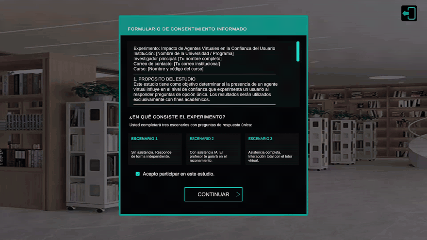
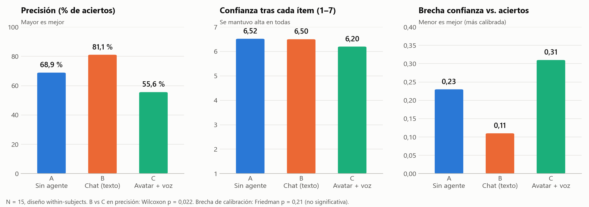
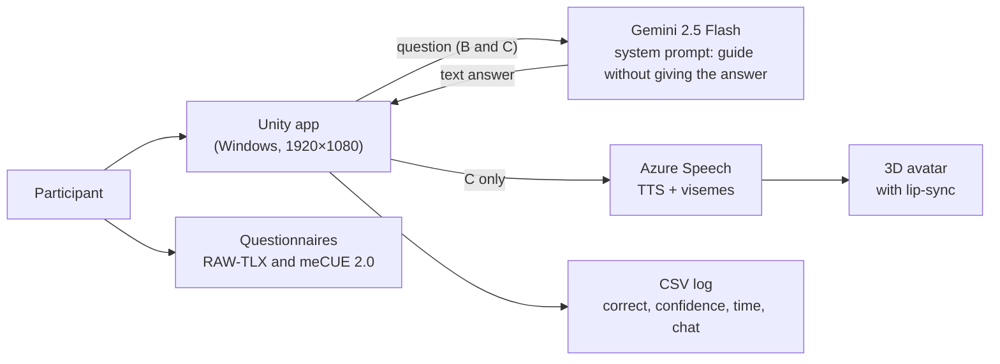

# Does a virtual agent with a face and a voice help?

A user study on how people's accuracy and trust change depending on how an AI assistant is
presented: no assistant, a text chat, or a 3D avatar that speaks. Both assistant versions used the
same language model and the same prompt; only the presentation changed.

The Unity prototype (pilot version): the menu with the three conditions and, in condition C, a participant asking the avatar for the exact answer. The agent refuses and points them to the rule.

Videos of each condition: [A, no agent](https://youtu.be/upMpOpCAWgQ) ·
[B, text chat](https://youtu.be/U_A_y0d-Hxg) · [C, avatar with voice](https://youtu.be/_h3h9BOnI18).
The results are written up as a short paper:
[article (PDF, Spanish)](docs/Entrega%203%20Articulo%20PF3311%20NeyFredJimenez%20B03230.pdf).

## Results

1. The text chat was more accurate: 81.1 % correct answers against 55.6 % with the avatar, with the
   same model and prompt (Wilcoxon p = 0.022; 95 % CI of the difference, 13 to 39 points). 11 of
   the 15 participants did better with text than with the avatar.
2. The avatar did not increase trust. Confidence was high in all three conditions (6.2 to 6.5 out
   of 7), and slightly lower with the avatar, not higher.
3. With the avatar, confidence matched accuracy less well: a calibration gap of 0.31 against 0.11
   with text. This difference is descriptive only (Friedman p = 0.21); several people reported high
   confidence and still got the answer wrong.
4. The avatar slowed everything down: about 177 s per question against about 114 s with no agent
   (56 % more), and more chat turns (4.4 against 3.6), without better answers.
5. People liked it anyway. The avatar's aesthetics scored 5.6 out of 7 (meCUE 2.0) and perceived
   workload didn't change (RAW-TLX about 4.3 in all three). A pleasant experience did not lead to
   better performance.
6. The agent never gave away an answer: zero cases in the logs, although at least one participant
   tried to get it to.

What this means for anyone designing AI assistants: when the answer is in a written rule, giving
the assistant a face and a voice can cost accuracy and time without adding trust. If the avatar
stays, the voice and waiting times should be lighter, or users should be able to switch to text.

## Study design

The question was whether accuracy, confidence and the match between them change with how the agent
is presented. 15 adults took part, recruited openly, most of them 25 to 34 with university or
technical studies. Each person went through all three conditions in counterbalanced order, answering
6 multiple-choice questions per condition about fictional rules, 18 in total:

- A: no agent.
- B: a chat with Gemini 2.5 Flash.
- C: the same chat, read aloud by a 3D avatar with Azure Speech and lip-sync.

I recorded whether each answer was right, the confidence (1 to 7), the time per question and the
chat log, plus RAW-TLX and meCUE 2.0 questionnaires after each block. The analysis used Friedman and
paired Wilcoxon tests with Holm/Bonferroni correction (α = 0.05). That gave 270 answers and no
invalid rows.

Limits: the sample is small (N = 15). Each block had different questions, so part of the difference
may come from how hard the items were. And participants ran the study on their own computers, which
affects voice latency and avatar rendering in condition C. The results guide the prototype's design;
they need a repeat study before being generalized.

## The prototype

The app is built in Unity 6 with C#. It runs the whole session (consent, choosing the condition,
the questions, confidence and the final screen) and writes a CSV per session. Gemini 2.5 Flash acts
as a tutor that guides without revealing the answer, with the same prompt in B and C. Azure Speech
produces the voice and the visemes for the avatar's lip-sync. Participants gave informed consent,
got an anonymous session ID and could leave and have their data deleted at any time. A few Python
scripts in [`_tools/`](_tools/) generate the questions from Word and the figures for the reports.

How to open and build it, configure the API keys, the CSV format and each script are described in
[`docs/REFERENCIA_TECNICA.md`](docs/REFERENCIA_TECNICA.md) (Spanish). The participant guide is
[`GUIA_PARTICIPANTE.md`](GUIA_PARTICIPANTE.md).

The avatar's 3D model comes from the 1toonteen package on the Unity Asset Store and is not in this
repository, because its license doesn't allow redistributing the original files. To open the full
project, import it from the Asset Store (Window › Package Manager › My Assets) into
`Assets/1toonteen/`; the scenes find it again by its GUID. The videos and the demo show the built
result.

## Documents (in Spanish)

- [Article with the results (PDF)](docs/Entrega%203%20Articulo%20PF3311%20NeyFredJimenez%20B03230.pdf)
- [Full results report (PDF)](docs/Entrega%203%20Informe%20Resultados%20PF3311%20NeyFredJimenez%20B03230.pdf)
- [Presentation (PPTX)](docs/Entrega%203%20Presentacion%20PF3311%20NeyFredJimenez%20B03230.pptx)
- [Researcher protocol (HTML)](docs/Protocolo_Investigador_PF3311_NeyFredJimenez.html)
- [Design and proof of concept](docs/Entregable2_PF3311_NeyFredJimenez(B03230).md)

Participant data is not published in this repository.

## Background

A project for PF-3311 Intelligent Virtual Agents (Dr. Alexander Barquero Elizondo), in the graduate
program in Computer Science at the University of Costa Rica, first semester of 2026. Third-party
models, services and assets keep their own licenses.

## Resumen en español

¿Ayuda más un asistente de IA con cara y voz? En un estudio piloto con 15 personas, cada una
respondió preguntas sobre reglas en tres condiciones: sin agente, con un chat de texto (Gemini 2.5
Flash) y con el mismo chat leído por un avatar 3D con voz. Con el mismo modelo y el mismo prompt, el
texto acertó el 81,1 % y el avatar el 55,6 % (Wilcoxon p = 0,022). El avatar no aumentó la confianza,
hizo cada pregunta un 56 % más lenta y aun así gustó. El artículo, el informe y la presentación están
en `docs/`.

## License

The code is under [PolyForm Noncommercial 1.0.0](LICENSE): you can read, run and modify it for
noncommercial purposes, including evaluating it for a job. Commercial use needs a license from me:
[neyfred@gmail.com](mailto:neyfred@gmail.com).

Ney Fred Jiménez Campos · [LinkedIn](https://www.linkedin.com/in/neyfred/) · [GitHub](https://github.com/jmnzcn)
